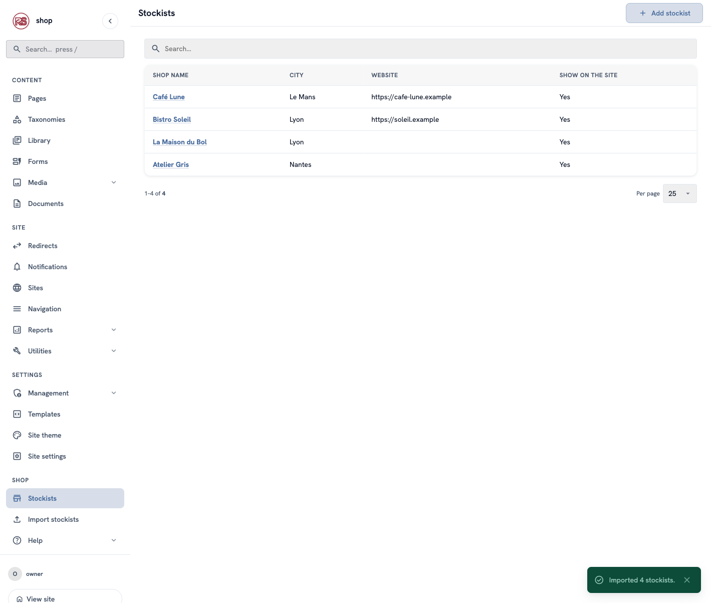
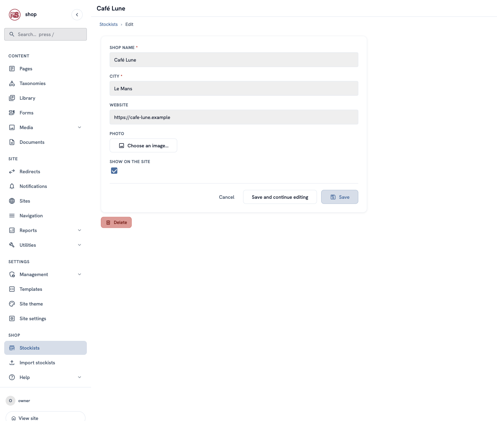
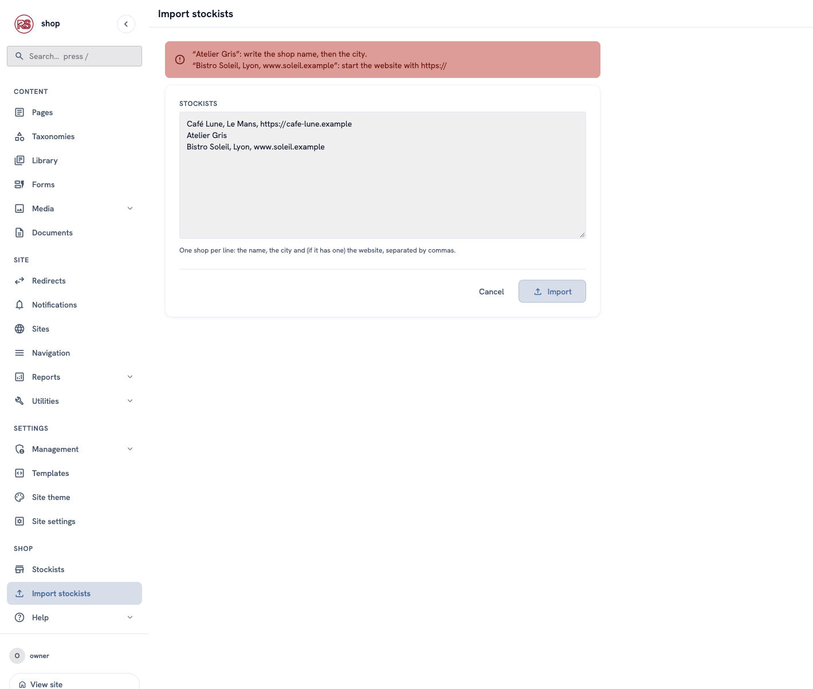
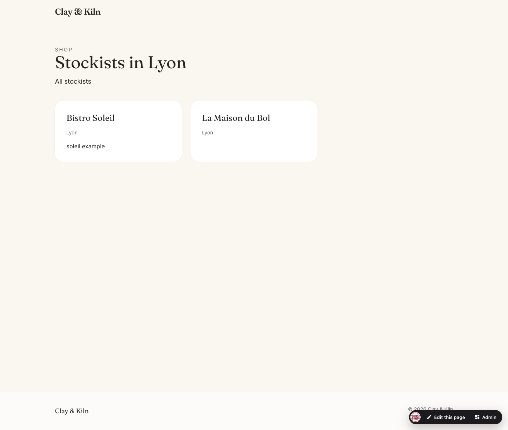

# Your own data in the admin

**Goal:** keep a list of the shops that sell Clay & Kiln pieces (the *stockists*), edit it in the admin, and show it on the site at `/shop/stockists`.

**Who this is for:** Rust developers who build a site with Rustango-CMS.

**Time:** about 25 minutes.

This is a developer chapter of [Build a ceramics shop, step by step](shop-overview.md). All code is in `examples/ceramics_shop/stockists.rs` and `examples/ceramics_shop/models.rs`.

## Pages or your own table?

Products are pages: each one has a URL, a draft and a live version, translations. A stockist is different. It is a row of data — a name, a city, a website — that other pages show. For data like this, use your own table and give editors a screen for it in the admin.

| You need… | Use |
|---|---|
| A list of records with a form to add, edit and delete them | `#[derive(CmsAdmin)]` on your model |
| A screen that does one job: an import, a report, a button that runs a task | `AdminPageHandler` + `register_admin_page!` |
| Extra URLs under a page, filled from your table | `routes`, `route_context` and `route_outcome` on the page type |

## The model and its editor



One derive gives the whole screen above — the list, the search box, the **Add stockist** button and the form:

```rust
#[derive(rustango::Model, rustango_cms::CmsAdmin, Debug, Clone, Serialize, Deserialize)]
#[rustango(table = "shop_stockist", app = "shop", display = "name")]
#[cms_admin(
    label = "Stockists",
    singular = "stockist",
    slug = "stockists",
    icon = "store",
    section = "Shop",
    list = "name, city, website, is_active",
    search = "name, city",
    ordering = "city, name"
)]
pub struct Stockist {
    #[rustango(primary_key)]
    pub id: Auto<i64>,
    #[rustango(max_length = 120)]
    #[field(widget = Text, label = "Shop name", required, max_length = 120)]
    pub name: String,
    #[rustango(max_length = 80)]
    #[field(widget = Text, label = "City", required, max_length = 80)]
    pub city: String,
    #[rustango(max_length = 200, default = "''")]
    #[field(widget = Url, label = "Website", placeholder = "https://")]
    pub website: String,
    #[field(widget = MediaPicker, label = "Photo")]
    pub photo: Option<i64>,
    #[rustango(default = "true")]
    #[field(widget = Boolean, label = "Show on the site")]
    pub is_active: bool,
}
```

The `#[field(...)]` attributes are the same ones page types use, so every widget works here too: text, numbers, dates, choices, the image chooser, the page chooser. A field without `#[field]` (here `id`) is not on the form.

The model also needs `Default` — a new record starts from it — and an `impl CmsAdminOverrides`. The stockist's `Default` sets `is_active: true`, so the **Show on the site** box starts ticked.

### The `#[cms_admin(...)]` options

| Option | Default | What it does |
|---|---|---|
| `label` | required | The plural name: the sidebar link and the list heading. |
| `singular` | the struct name in words | Used in "Add stockist" and in messages. |
| `slug` | the table name | The screen's address: `/cms-admin/x/stockists`. |
| `icon` | none | A [Material Symbols](https://fonts.google.com/icons) name for the sidebar. |
| `section` | `Tools` | The sidebar group. `content`, `site` and `settings` are the built-in groups; any other name makes a new group. |
| `sort_order` | `100` | The order inside the group. |
| `list` | `admin(list_display)`, else the first three fields | The list columns. The first column links to the form. |
| `search` | `admin(search_fields)` | Text fields the search box looks in. No search fields, no search box. |
| `ordering` | `admin(ordering)`, else the primary key | The list order. `-name` sorts backwards. |
| `form` | the order of the fields | The order of the boxes on the form, for example `form = "name, city, website"`. |
| `per_page` | `25` | Rows on each list page. Editors can change it below the list. |
| `permission` | the table name | The name of the screen's row in **Roles** (see below). |
| `title` | `display`, else `#<id>` | The field that names a record in headings and messages. |

### Who can use it

The screen adds a row to the role matrix in **Management → Roles**, named by `permission` (here `shop_stockist`), with four boxes:

| Box | Allows |
|---|---|
| view | Opening the list and the forms. Without **edit**, the form is read-only and has no **Save** button. |
| add | **Add stockist**. |
| edit | **Save** on an existing stockist. |
| delete | The **Delete** button. |

Superusers can do everything. The check runs on the server for every request, so hiding a button is not the only protection.

### Make the table

As for any model, generate the migration and run it:

```sh
cargo run --example ceramics_shop -- makemigrations
cargo run --example ceramics_shop -- migrate-tenants
```

If `makemigrations` says *the chain has branched*, the CMS has new migrations since your last one. Run `makemigrations --merge` once, then `makemigrations` again.

## Rules: `CmsAdminOverrides`



Every method has a default, so `impl CmsAdminOverrides for Stockist {}` is enough to start. The stockist only checks the website:

```rust
#[async_trait]
impl CmsAdminOverrides for Stockist {
    async fn validate(&self, _pool: &Pool) -> Vec<FieldError> {
        if bad_website(&self.website) {
            return vec![FieldError::new("website", "Start the address with https://")];
        }
        Vec::new()
    }
}
```

When `validate` returns errors, nothing is saved: the form comes back with the editor's text and the message under the field. A value that does not parse (letters in a number box) and an empty required box are checked before `validate`, with no code.

| Method | Default | Use it to… |
|---|---|---|
| `validate(&self, pool)` | no errors | Check values: a format, a unique name, a link between two fields. Use `FieldError::new("_form", …)` for a message about the whole form. |
| `read_only_fields(&self, pool)` | none | Show some fields without letting editors change them, for example fields another system fills. |
| `can_create(pool)` | `true` | Hide **Add** and refuse new records. |
| `can_delete(&self, pool)` | `true` | Hide **Delete** for some records. |
| `field_options(pool, field)` | the declared options | Fill a `Select`, `Radio`, `Checkboxes` or `MultiSelect` box from the database — for example a list of another table's rows for a foreign key. |
| `extra_widgets(&self, pool)` and `save_extra(&self, pool, form)` | none | Boxes for data that is not a column of the table, such as a many-to-many list, and storing what they post. |
| `after_save(&self, pool, created)` | nothing | Do something after a save: clear a cache, send a message. |
| `before_delete(&self, pool)` | nothing | Remove or update dependent rows. An error cancels the delete. |
| `list_column(pool, rows, column)` | the field's value | Fill a list column with something computed, for all rows of the page at once. The column name does not have to be a field. |

### A many-to-many list

Suppose each stockist sells some of the clay types from [the Clay vocabulary](shop-dev-helper-traits.md). There is no column for this — the links live in their own table — so the form gets an extra box, and `save_extra` stores it:

```rust
async fn extra_widgets(&self, pool: &Pool) -> Vec<Widget> {
    let chosen: Vec<String> = clay_ids_for(pool, self.id.get().copied()).await
        .iter().map(ToString::to_string).collect();
    vec![Widget::new(WidgetKind::Checkboxes, "clays", "Clay types")
        .with_options(all_clays(pool).await)            // (id, name) pairs
        .with_value(serde_json::to_string(&chosen).unwrap_or_default())]
}

async fn save_extra(&self, pool: &Pool, form: &AdminForm) -> Result<(), ExecError> {
    // A checkbox list posts a JSON array of the ticked values.
    let Some(raw) = form.get("clays") else { return Ok(()) };
    let ids: Vec<String> = serde_json::from_str(raw).unwrap_or_default();
    replace_clay_links(pool, self.id.get().copied(), &ids).await
}
```

`save_extra` runs after the record is saved, so `self` already has its id. `clay_ids_for`, `all_clays` and `replace_clay_links` are your own small queries.

### A computed column

`list_column` gets the rows of the current list page, so one query covers them all. To show how many products each stockist sells, from a links table:

```rust
async fn list_column(pool: &Pool, rows: &[Self], column: &str) -> Option<Vec<String>> {
    if column != "products" {
        return None; // the other columns keep their values
    }
    let counts = product_counts(pool).await; // one query: stockist id → count
    Some(rows.iter().map(|r| {
        let id = r.id.get().copied().unwrap_or_default();
        counts.get(&id).copied().unwrap_or(0).to_string()
    }).collect())
}
```

and add `products` to `list = "…"`.

> **Avoid N+1 queries.** Never run one query per row inside `list_column`.

## A screen of your own: Import stockists



Some jobs are not "a list and a form". The shop owner gets a list of new stockists by email and wants to paste it in one go. That is a custom admin page: a struct that implements `AdminPageHandler`, registered with `register_admin_page!`. It lives at `/cms-admin/x/<slug>` and gets the admin's sidebar, header, colours and messages.

```rust
#[derive(Default)]
pub struct StockistImport;

#[async_trait]
impl AdminPageHandler for StockistImport {
    fn slug(&self) -> &'static str { "stockist-import" }
    fn label(&self) -> &'static str { "Import stockists" }
    fn icon(&self) -> Option<&'static str> { Some("upload") }
    fn section(&self) -> SidebarSection { SidebarSection::Custom("Shop") }
    fn sort_order(&self) -> i32 { 110 }
    fn permission_resource(&self) -> Option<&'static str> { Some("shop_stockist_import") }

    async fn render(&self, ctx: AdminPageCtx<'_>) -> Response {
        let mut tctx = tera::Context::new();
        tctx.insert("lines", "");
        tctx.insert("errors", &Vec::<String>::new());
        ctx.render("stockist_import.html", &mut tctx).await
    }

    async fn post(&self, ctx: AdminPageCtx<'_>, form: AdminForm) -> Response {
        let lines = form.text("lines");
        // … parse each line into a Stockist; on errors, render the form again
        //   with `lines` and the messages …
        let pool = ctx.tenant.pool();
        let mut added = 0;
        for mut stockist in parsed {
            if let Err(e) = stockist.save(pool).await {
                return ctx.redirect(&ctx.page_url(), MessageLevel::Error, &format!("Stopped after {added}: {e}"));
            }
            added += 1;
        }
        let noun = if added == 1 { "stockist" } else { "stockists" };
        ctx.redirect("/cms-admin/x/stockists", MessageLevel::Success, &format!("Imported {added} {noun}."))
    }
}

rustango_cms::register_admin_page!(StockistImport);
```

`render` answers a `GET`, `post` answers a form sent to the page. Before `post` runs, the CMS has checked that the editor is signed in, that the form's security token is right, and that the editor's role allows it. You write only the job.

### What `AdminPageCtx` gives you

| Part | What it is |
|---|---|
| `ctx.render(template, &mut context)` | Shows your template inside the admin. It adds the sidebar (with your page marked), the signed-in user, the admin colours and language, `csrf_token`, and the messages waiting to be shown. |
| `ctx.redirect(url, level, message)` | Goes to `url` and shows `message` there. `level` is `MessageLevel::Success`, `Info`, `Warning` or `Error`. |
| `ctx.query()`, `ctx.query_param("q")` | The query string: `?q=lyon` → `Some("lyon")`. |
| `ctx.action` | The part of the address after the slug: `/cms-admin/x/stockist-import/preview` → `Some("preview")`. One page can answer several addresses this way. |
| `ctx.has_perm("shop_stockist.add")` | Whether the editor's role has a permission. |
| `ctx.tenant.pool()` | The site's database. |
| `ctx.user` | The signed-in user. |
| `ctx.page_url()` | `/cms-admin/x/<slug>`. |

### Reading the form: `AdminForm`

| Method | Gives |
|---|---|
| `form.get("name")` | The value as sent, or `None`. |
| `form.text("name")` | The value without spaces at the ends; empty if missing. |
| `form.opt_text("name")` | The same, but `None` when empty. |
| `form.int("qty")`, `form.float("price")` | A number, or `None`. |
| `form.checked("agree")` | `true` for a ticked checkbox. |
| `form.all("tag")`, `form.ints("id")` | Every value of a name that appears many times. |

### Who can use it

`permission_resource()` adds a row to **Management → Roles** with **view** and **edit**: **view** opens the page, **edit** may send its form. To ask for **add** or **delete** instead, return them from `permission_actions()` and send the form to `/cms-admin/x/<slug>/new` or `/cms-admin/x/<slug>/delete`.

Without `permission_resource()`, any editor who can use the admin can use the page.

### The template

The template extends the admin's base and uses the admin's own classes, so it looks like every other screen. Part of `templates_admin/stockist_import.html`:

```jinja

Import stockists

<form method="post" action="/cms-admin/x/stockist-import" class="rcms-card rcms-maxw-760">
    {{ csrf_token | csrf_input | safe }}
    <div class="rcms-field">
        <label for="lines">Stockists</label>
        <textarea id="lines" name="lines" rows="10">{{ lines }}</textarea>
    </div>
    <div class="rcms-form-actions">
        <button type="submit" class="rcms-btn">Import</button>
    </div>
</form>

```

A template that extends `rcms_admin/_base.html` can only be added after the admin's templates. Keep it out of your public `templates/` folder and add it in `main`:

```rust
rustango_cms::admin::register_templates(&mut tera)?;
tera.add_raw_template("stockist_import.html", include_str!("templates_admin/stockist_import.html"))?;
```

## Show the stockists on the site



The shop page answers two more addresses: `/shop/stockists` and `/shop/stockists/<city>`. Three methods of its `PageTypeOverrides` do this:

```rust
fn routes(&self) -> Vec<RouteSpec> {
    vec![
        RouteSpec::new(r"stockists", "stockists"),
        RouteSpec::new(r"stockists/(?P<city>[a-z0-9-]+)", "stockists_in_city"),
    ]
}

async fn route_context(&self, pool: &Pool, _page: &Page, matched: &RouteMatch)
    -> Result<Map<String, Value>, ExecError>
{
    let mut stockists = crate::stockists::active(pool).await;
    let mut ctx = Map::new();
    if let Some(city) = matched.captures.get("city") {
        stockists.retain(|s| &s.city_slug() == city);
        if let Some(first) = stockists.first() {
            ctx.insert("city".to_owned(), json!(first.city));
        }
    }
    // Each row also carries its city as it appears in URLs (`le-mans`).
    let rows: Vec<Value> = stockists.iter().map(|s| {
        let mut row = json!(s);
        row["city_slug"] = json!(s.city_slug());
        row
    }).collect();
    ctx.insert("stockists".to_owned(), Value::Array(rows));
    Ok(ctx)
}

fn route_outcome(&self, matched: &RouteMatch, route_ctx: &Map<String, Value>) -> RouteOutcome {
    if matched.name == "stockists_in_city" && !route_ctx.contains_key("city") {
        return RouteOutcome::NotFound;
    }
    RouteOutcome::Template("stockists.html".to_owned())
}
```

| Method | What it does |
|---|---|
| `routes()` | The extra addresses, as patterns under the page's own address. Named groups like `(?P<city>…)` arrive in `matched.captures`. |
| `route_context(…)` | The data for the template, for the address that matched. |
| `route_outcome(matched, route_ctx)` | What to answer, after `route_context`: `RouteOutcome::Render` (the page's own template, the default), `RouteOutcome::Template("…")` (another template), or `RouteOutcome::NotFound`. |

`NotFound` gives the visitor the site's normal **404** page with the status code 404, so search engines do not keep `/shop/stockists/paris` when Paris has no stockist.

### Add to `page`

The shop page links to the list: "Find us in 4 shops". The number comes from `public_context`:

```rust
async fn public_context(&self, pool: &Pool, _page: &Page) -> Result<Map<String, Value>, ExecError> {
    let mut ctx = Map::new();
    let count = crate::stockists::active(pool).await.len();
    ctx.insert("page".to_owned(), json!({ "stockist_count": count }));
    Ok(ctx)
}
```

Keys under `"page"` join the page's own, so the template writes `{{ page.stockist_count }}` next to `{{ page.title }}`. They only add: a key the page already has (`title`, `url_path`…) keeps the page's value.

## Check it worked

Start the shop and sign in:

- The sidebar has a **Shop** group with **Stockists** and **Import stockists**.
- Paste `Atelier Gris` on the import screen: the screen shows an error and keeps your text.
- Paste `Café Lune, Le Mans, https://cafe-lune.example`: the list opens with "Imported 1 stockist."
- Open `/shop/stockists` and `/shop/stockists/le-mans` on the site; `/shop/stockists/paris` is the 404 page.
- In **Management → Roles**, the **Stockists** row has view, add, edit and delete boxes.

## If something goes wrong

| Problem | What to do |
|---|---|
| The screen is not in the sidebar. | Name the type once in `main`: `let _ = std::any::type_name::<rustango_cms::CmsAdminPage<stockists::Stockist>>();` (and the same for an `AdminPageHandler`), rebuild and restart. |
| `no such table: shop_stockist` | Run `makemigrations` and `migrate-tenants`. |
| The compiler says `CmsAdminOverrides` is not implemented. | Add `impl rustango_cms::CmsAdminOverrides for Stockist {}`. |
| The compiler says `Default` is not implemented. | Derive or write `Default` for the model. |
| `Template 'rcms_admin/_base.html' not found` at start. | The admin template is in the public `templates/` folder. Move it out and add it after `register_templates` (see "The template"). |
| An extra address shows the page itself, not your template. | `route_outcome` returned `Render`. Return `RouteOutcome::Template("…")`. |

## Next

Back to [the list of chapters](shop-overview.md).
